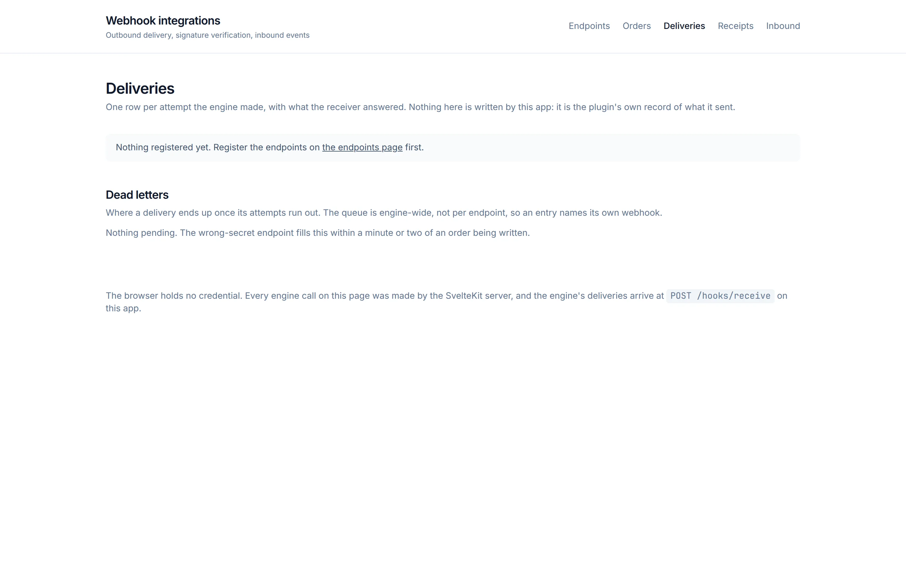
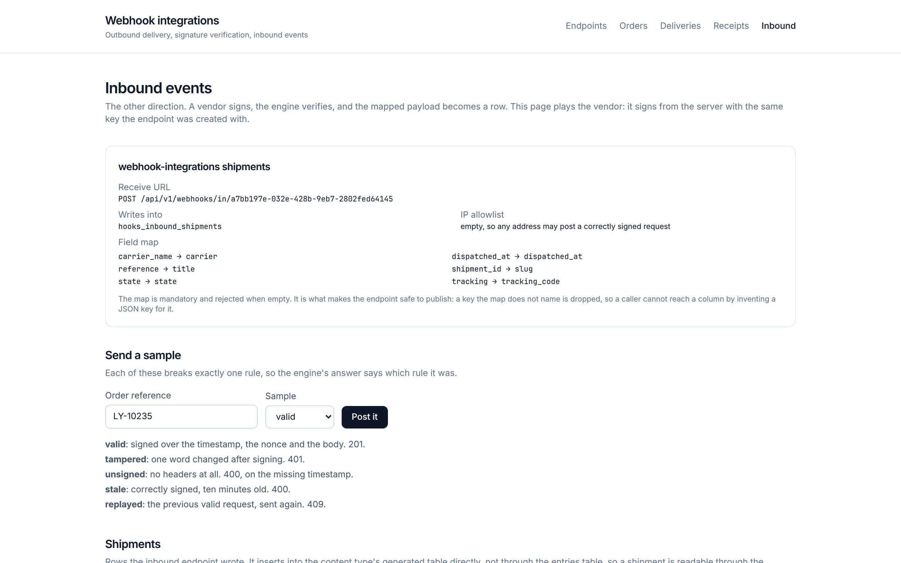
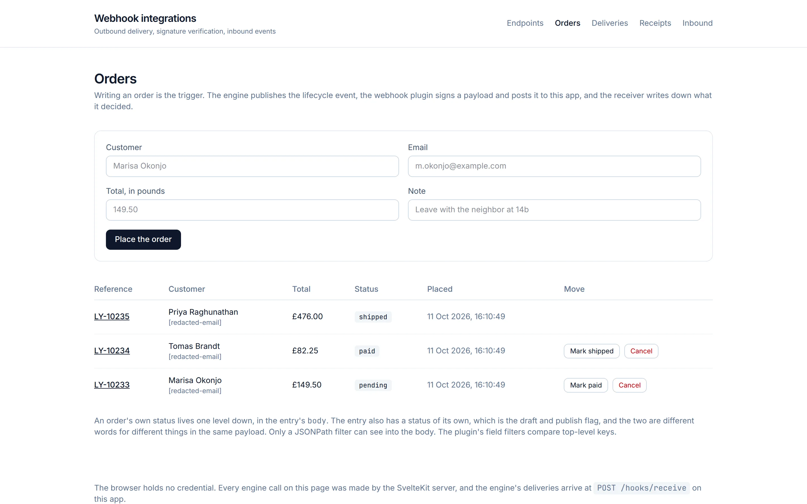
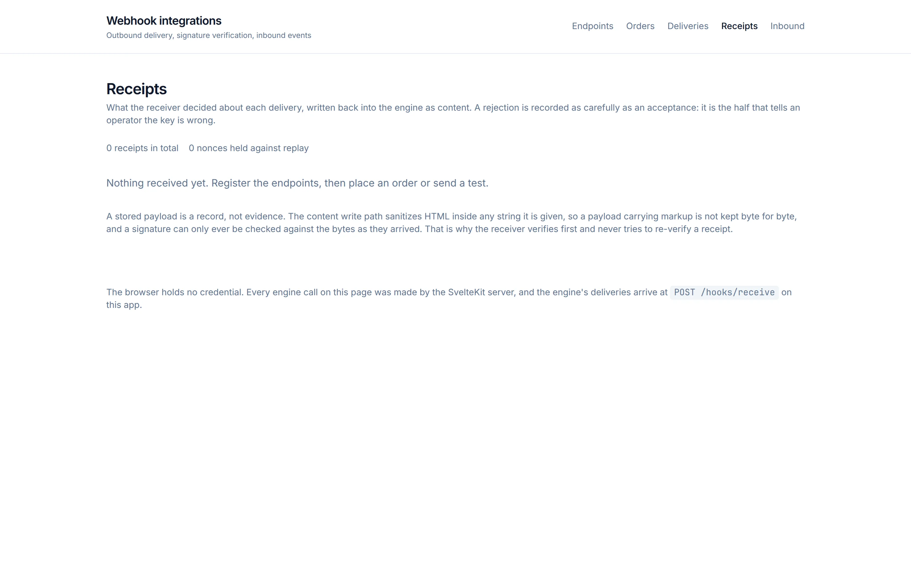
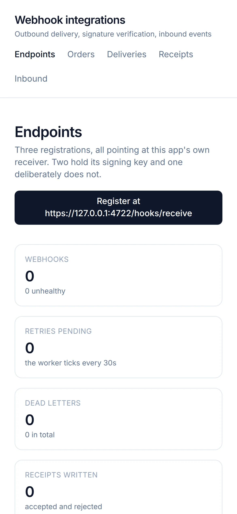

# Webhooks, both directions

Deliveries out of the engine with the signature verified on arrival, and signed
requests in. The point of the example is the verification: a webhook receiver
that does not check the signature is an unauthenticated write endpoint with
extra steps.

## Preview

Every page of this example, captured from a running stack with its seeded content.

<table>
  <tr>
    <td width="50%" valign="top"> <b>Webhook endpoints</b> <code>/</code></td>
    <td width="50%" valign="top"> <b>Deliveries</b> <code>/deliveries</code></td>
  </tr>
  <tr>
    <td width="50%" valign="top"> <b>Inbound events</b> <code>/inbound</code></td>
    <td width="50%" valign="top"> <b>Orders</b> <code>/orders</code></td>
  </tr>
  <tr>
    <td width="50%" valign="top"> <b>Receipts</b> <code>/receipts</code></td>
    <td width="50%" valign="top"> <b>On a phone</b> <code>/</code></td>
  </tr>
</table>

`make screenshots APPS=webhook-integrations` at the repository root captures them again. [docs/PREVIEWS.md](../../docs/PREVIEWS.md) says how they are made and how to use them.

## Read this first

**The engine's delivery carries no webhook id.** A receiver cannot tell which
registration sent a request from anything the engine puts on the wire. Each
registration here adds an `x-integration-channel` header, and that header is the
only attribution this app has. It is unverified: a caller can send any value, so
the receiver narrows it to a known channel and records anything else as
`unknown`. Do not treat it as identity.

**Two senders inside the engine sign differently.** The scheme below is what the
dispatcher sends, and it includes a timestamp and a single-use nonce, which is
what makes a captured request unreplayable. Not every path sets both. When they
are absent the receiver can still verify the body, but it cannot detect a
replay, so it records the weaker verdict `accepted-body-only` rather than
pretending the request was as safe as the others. A receiver that accepted both
as equal would be advertising replay protection it does not have.

**The registration URL must be reachable from the engine.** Outbound delivery is
SSRF-validated and refuses private and loopback addresses. The examples stack
sets `WEBHOOK_ALLOWED_PRIVATE_NETWORKS=127.0.0.0/8,::1/128` so a receiver on the
same machine can be reached. Without it, every delivery to this app fails
validation before it leaves.

## The signing scheme

Enough detail to verify in any language:

| Header | Value |
|---|---|
| `X-Webhook-Signature` | `<algo>=<hex>`, algo one of `sha256`, `sha384`, `sha512` |
| `X-Webhook-Algorithm` | used only when the signature carries no `<algo>=` prefix |
| `X-Webhook-Timestamp` | unix seconds |
| `X-Webhook-Nonce` | a UUID, single use |
| `X-Webhook-Event` | `after_create`, `after_update`, `after_delete`, `test`, `retry` |
| `X-Webhook-Schema` | the content type the event came from |

The signed string is

    HMAC(secret, "<timestamp>.<nonce>.<raw request body>")

with the secret used as **raw bytes, never hex-decoded**, and the body signed
exactly as it arrived. Sign the bytes you received, not a re-serialized object:
re-encoding JSON changes key order and whitespace and the digest will not match.

Tolerance is 300 seconds behind and 30 ahead. The nonce is held for the window
plus a margin, which is what rejects a replay inside it.

## What the receiver records

Every request lands as a receipt, including the ones it rejects, because a
receiver that silently drops what it cannot verify gives you nothing to debug:

`accepted` · `accepted-body-only` · `missing-signature` · `malformed-signature` ·
`unknown-algorithm` · `stale-timestamp` · `replayed` · `signature-mismatch` ·
`invalid-json` · `ignored`

One registration is deliberately configured with the wrong secret, so the
`signature-mismatch` path is exercised on every run rather than being theory.

## Pages

    /             what is registered and what it proves
    /orders       create an order, which fires a delivery
    /deliveries   the engine's own delivery log, attempts and retry config
    /receipts     what this receiver saw, verdict by verdict
    /inbound      an incoming webhook definition, with signed sample requests
    /hooks/receive  the receiver itself, not a page

The inbound page can send a valid request, an unsigned one, one with a stale
timestamp, a replay of the last valid one, and a tampered body, so each rejection
can be seen rather than described.

## Run it

From the repository root, with the stack up:

    make up && make install
    cd apps/webhook-integrations && pnpm run setup && pnpm dev

Then open http://localhost:5187 and use **Register** on the endpoints page to
point the engine at this app. Registration is a runtime action rather than part
of provisioning, because the URL depends on where the app is actually listening.

## What the product does not do

- **No webhook id on delivery**, so attribution is a header you set yourself.
- **No uniform signing across senders**, so a receiver needs both modes.
- **Registration is super-admin**, so a tenant cannot manage its own webhooks
  through this API.
- Verifying an inbound request is entirely the receiver's job. The engine's own
  inbound route checks a signature when a secret is configured, but nothing
  forces you to configure one, and a webhook with no secret is an open endpoint.
