# Previews

Every example carries a picture of each of its pages in
`apps/<example>/screenshots/`. A script in this repository takes them from the
running apps and their seeded content, so anyone can take them again and get
the same pages.

## What is captured

- Every page route in an example's `src/routes`, once. A route with a
  parameter, such as `/posts/[slug]`, is captured at the first link to it that
  the app's own pages show, so no image shows a page the content does not have.
- A page no link reaches, or one that prints facts about the machine it was
  captured on, is left out. The example's README names it and says why.
- On a desktop: a 1440 by 900 viewport rendered at twice the pixel density, so
  each image is 2880 by 1800 pixels.
- On a phone: the example's first page in a 390 by 844 viewport at three times
  the density, 1170 by 2532 pixels.
- WebP at quality 82. Motion is stopped and the text caret hidden before each
  capture, so two runs over the same content give the same picture.
- `index.json` beside the images names the route, the exact URL and the page
  title of every image.

## Take them again

    make up
    make setup
    make build
    make preview
    make screenshots                       # every example being served
    make screenshots APPS=blog,helpdesk    # only these

The script rewrites the Preview section of each example's README and the
gallery below. Commit new images together with the change that altered the
page, so a picture never shows something the code no longer does.

## Using them

The images fall under the repository's MIT license, like the code. When one
goes into an article, a slide or a product page:

- Show it as it is. Crop to the part you are talking about, but never paint in
  a feature, a number or content the example does not have.
- Name the example and the page in the caption and the alt text. The README's
  Preview section gives both, and `index.json` adds the route.
- Everything on screen is seeded sample content.
- Show the desktop image at 1440 pixels wide on an ordinary screen, and at its
  full size only where it is displayed large.
- Take a new set after a design change rather than reusing an older image.

## Gallery

The first page of every example. Each one links to all of its pages.

<table>
  <tr>
    <td width="50%" valign="top"><a href="../apps/analytics-dashboard/#preview">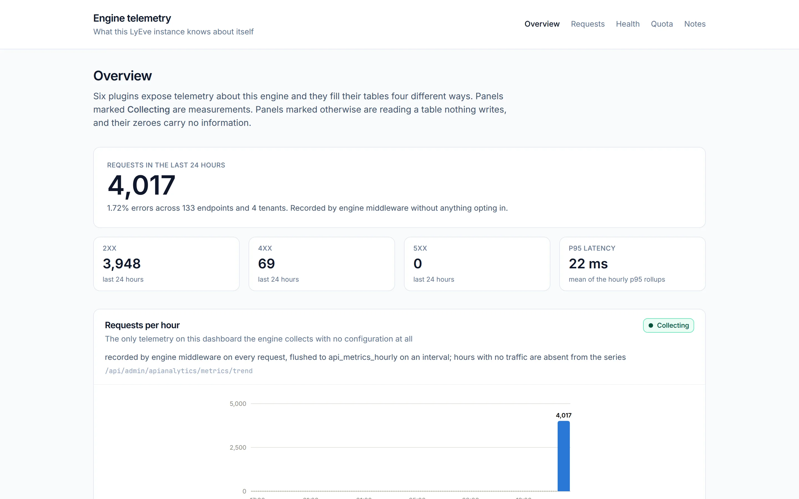</a> <b><a href="../apps/analytics-dashboard/">analytics-dashboard</a></b>, 5 pages A console over the engine's own telemetry, each panel naming its route.</td>
    <td width="50%" valign="top"><a href="../apps/blog/#preview">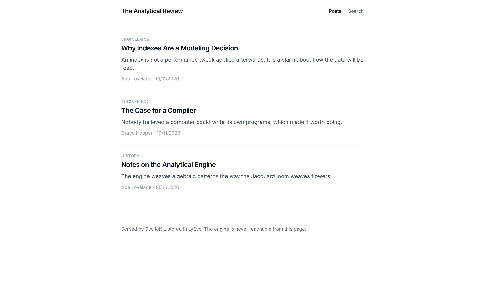</a> <b><a href="../apps/blog/">blog</a></b>, 3 pages Relations, `populate`, full-text search, media. The reference implementation.</td>
  </tr>
  <tr>
    <td width="50%" valign="top"><a href="../apps/booking/#preview">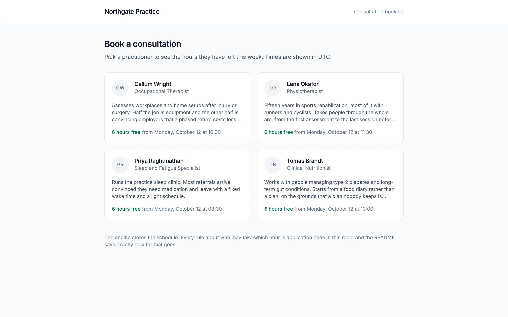</a> <b><a href="../apps/booking/">booking</a></b>, 3 pages Scheduling modeled entirely in the application, and why it is not race-free.</td>
    <td width="50%" valign="top"><a href="../apps/cms-migration/#preview">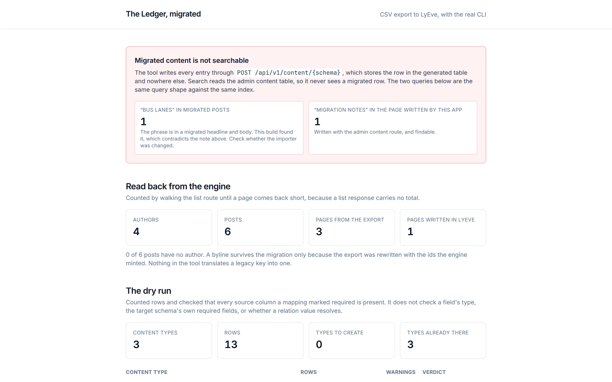</a> <b><a href="../apps/cms-migration/">cms-migration</a></b>, 2 pages Migrating in from a CSV export using the real command-line tool.</td>
  </tr>
  <tr>
    <td width="50%" valign="top"><a href="../apps/community-forum/#preview">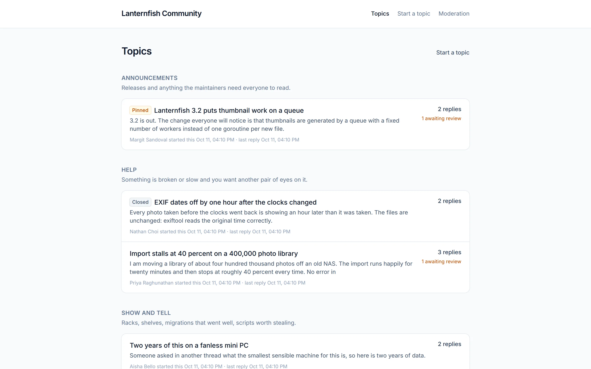</a> <b><a href="../apps/community-forum/">community-forum</a></b>, 4 pages Threaded discussion and a moderation queue on the schema plugin's comments preset.</td>
    <td width="50%" valign="top"><a href="../apps/company-site/#preview">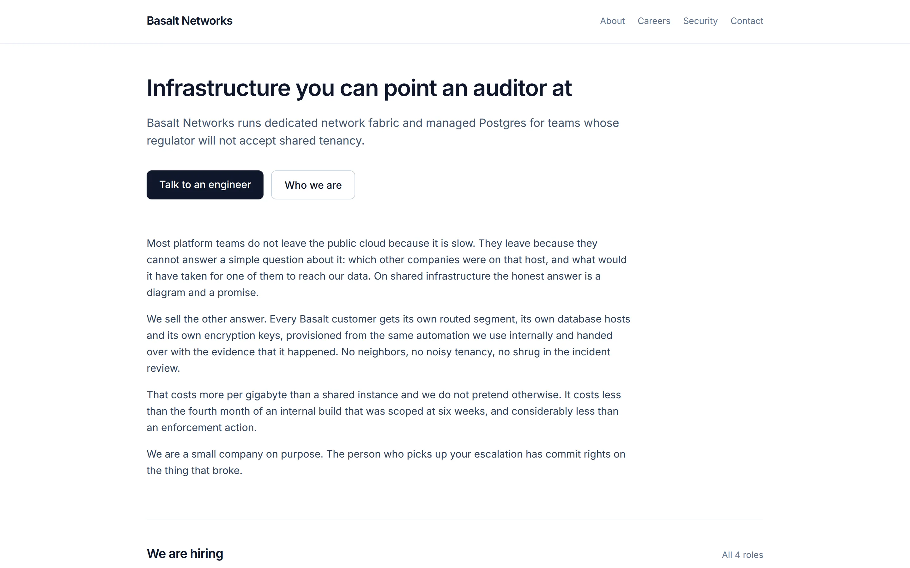</a> <b><a href="../apps/company-site/">company-site</a></b>, 6 pages A contact form on the schema plugin's forms preset, and a generated sitemap.</td>
  </tr>
  <tr>
    <td width="50%" valign="top"><a href="../apps/docs-portal/#preview">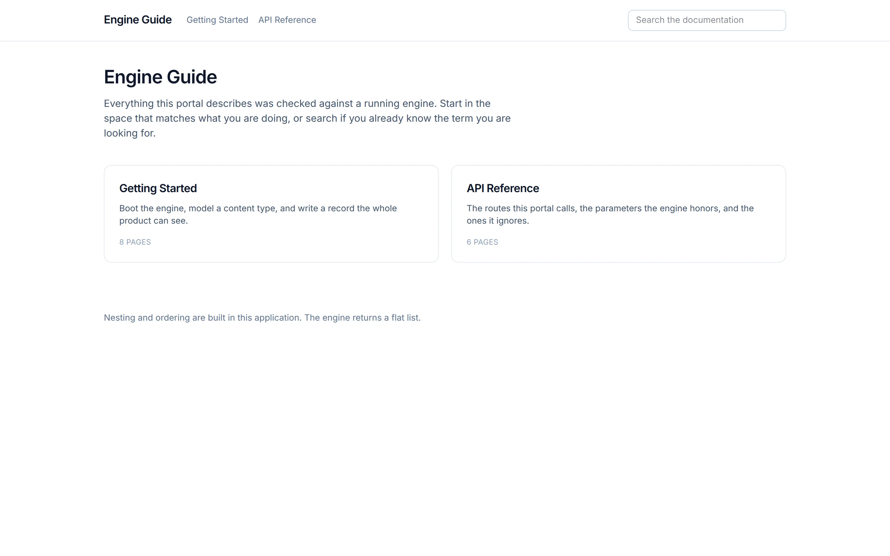</a> <b><a href="../apps/docs-portal/">docs-portal</a></b>, 4 pages Hierarchical content and a page tree the app builds itself.</td>
    <td width="50%" valign="top"><a href="../apps/events-ticketing/#preview">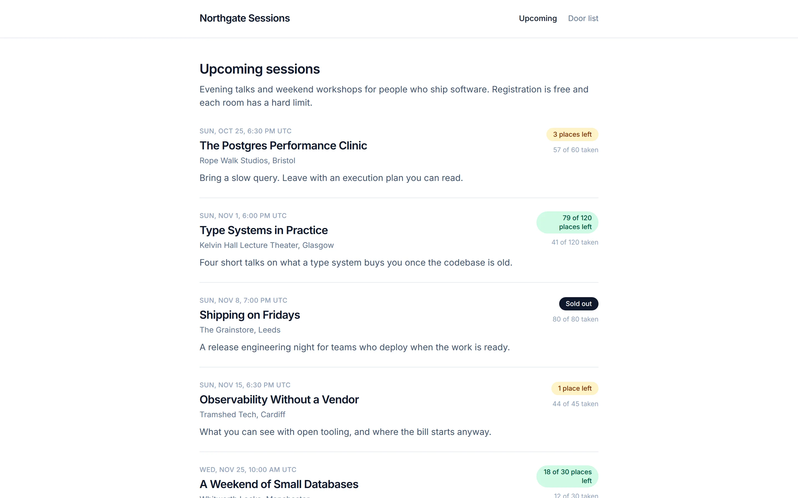</a> <b><a href="../apps/events-ticketing/">events-ticketing</a></b>, 3 pages Capacity as application state.</td>
  </tr>
  <tr>
    <td width="50%" valign="top"><a href="../apps/graphql-storefront/#preview">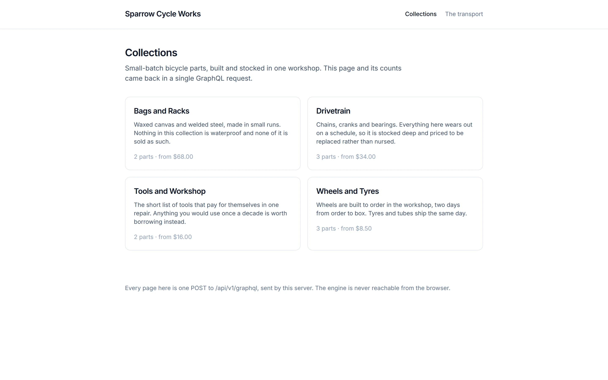</a> <b><a href="../apps/graphql-storefront/">graphql-storefront</a></b>, 4 pages The GraphQL transport end to end, and where it is thinner than REST.</td>
    <td width="50%" valign="top"><a href="../apps/helpdesk/#preview">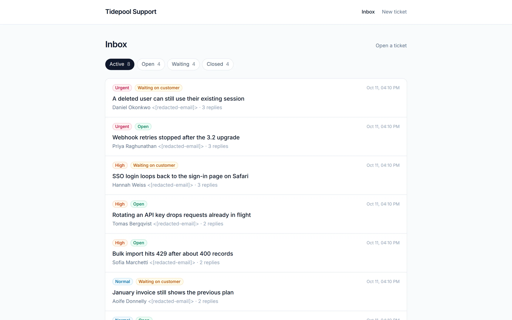</a> <b><a href="../apps/helpdesk/">helpdesk</a></b>, 3 pages Ticket status workflow and threaded replies.</td>
  </tr>
  <tr>
    <td width="50%" valign="top"><a href="../apps/jobs-board/#preview">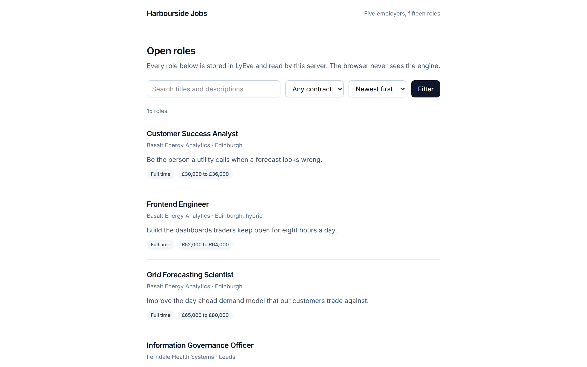</a> <b><a href="../apps/jobs-board/">jobs-board</a></b>, 2 pages Public submissions with a file upload.</td>
    <td width="50%" valign="top"><a href="../apps/lms-courses/#preview">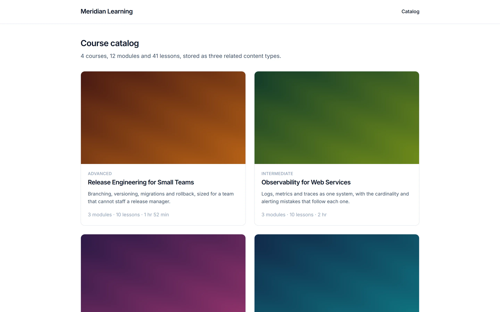</a> <b><a href="../apps/lms-courses/">lms-courses</a></b>, 3 pages Three levels of nesting and walking relations upward.</td>
  </tr>
  <tr>
    <td width="50%" valign="top"><a href="../apps/marketplace/#preview">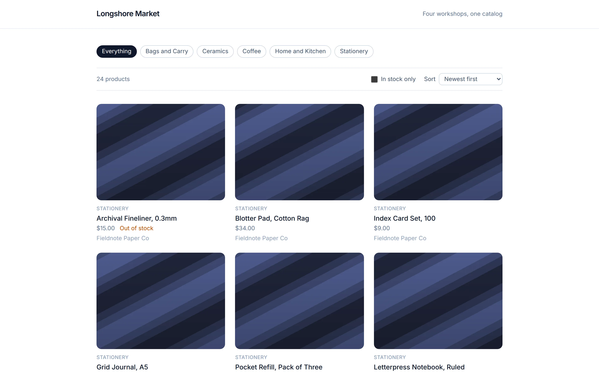</a> <b><a href="../apps/marketplace/">marketplace</a></b>, 3 pages Multi-relation catalog, filtering, and what the engine cannot filter.</td>
    <td width="50%" valign="top"><a href="../apps/media-library/#preview">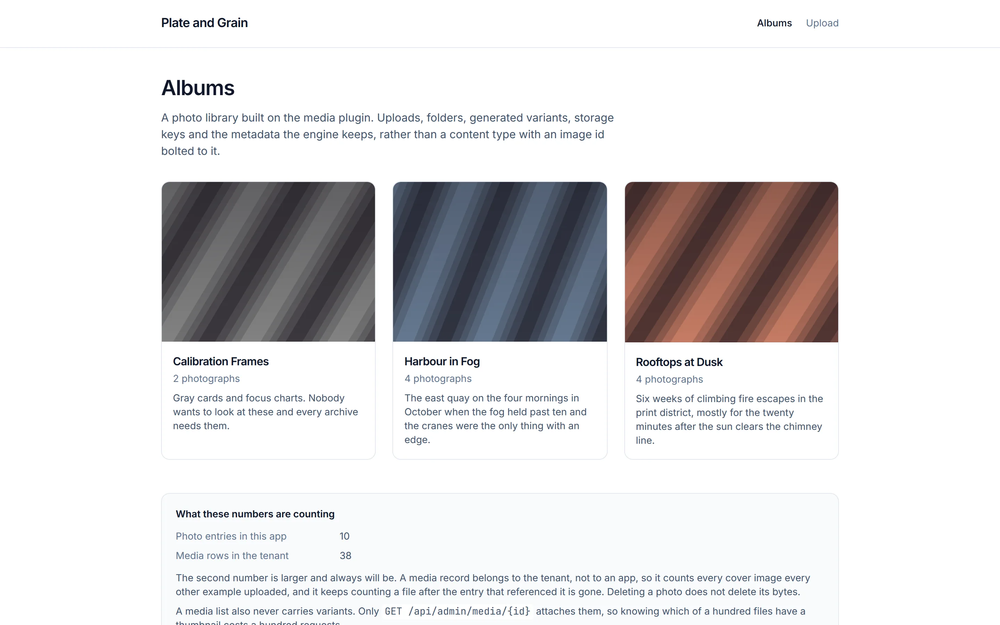</a> <b><a href="../apps/media-library/">media-library</a></b>, 5 pages The media pipeline itself: uploads, folders, variants and storage keys.</td>
  </tr>
  <tr>
    <td width="50%" valign="top"><a href="../apps/mobile-api-backend/#preview">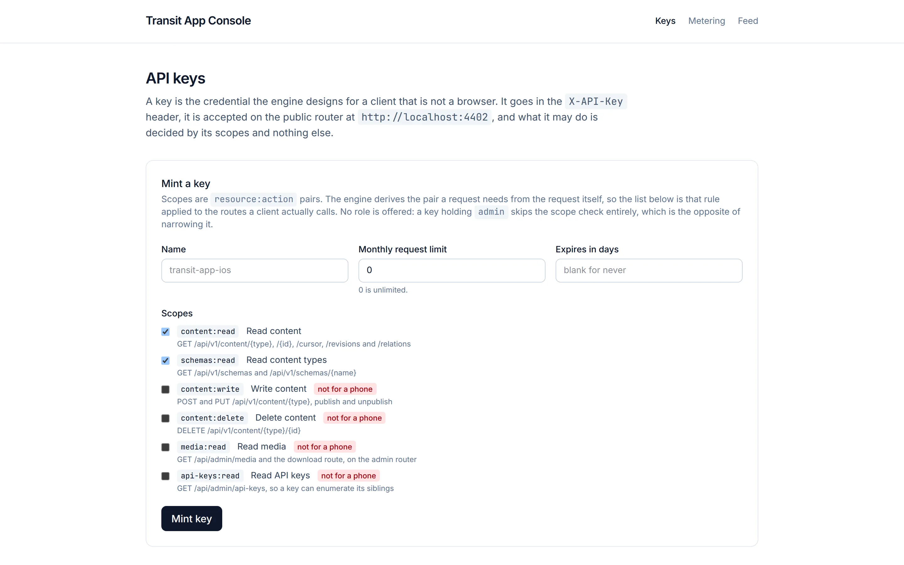</a> <b><a href="../apps/mobile-api-backend/">mobile-api-backend</a></b>, 4 pages Scoped API keys, quota and metering, with a non-browser client.</td>
    <td width="50%" valign="top"><a href="../apps/multi-language-site/#preview">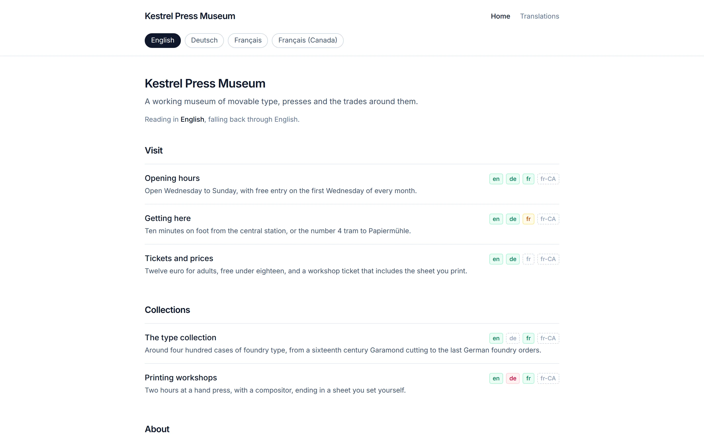</a> <b><a href="../apps/multi-language-site/">multi-language-site</a></b>, 4 pages Per-entry translations, locale fallback and translation status.</td>
  </tr>
  <tr>
    <td width="50%" valign="top"><a href="../apps/newsroom/#preview">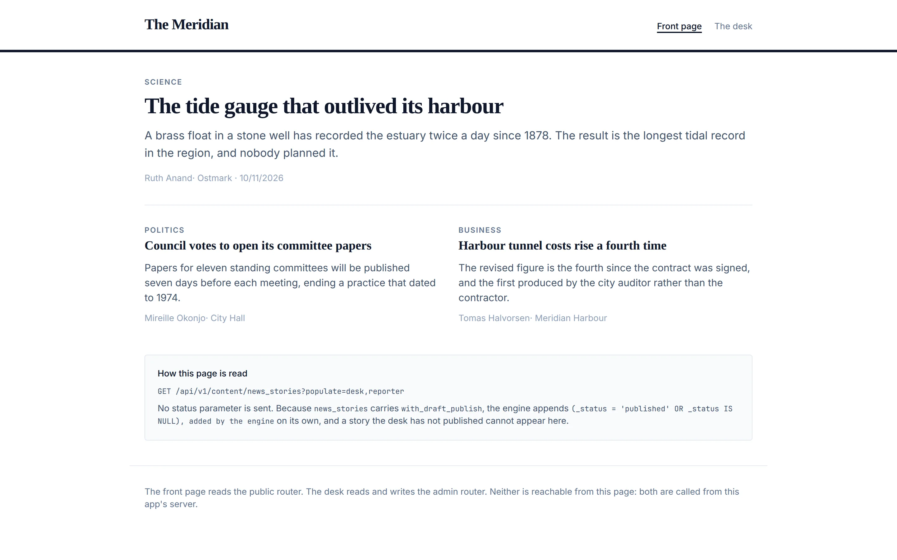</a> <b><a href="../apps/newsroom/">newsroom</a></b>, 5 pages Drafts, publishing, revisions with restore, and a staged approval on the review plugin.</td>
    <td width="50%" valign="top"><a href="../apps/privacy-compliance/#preview">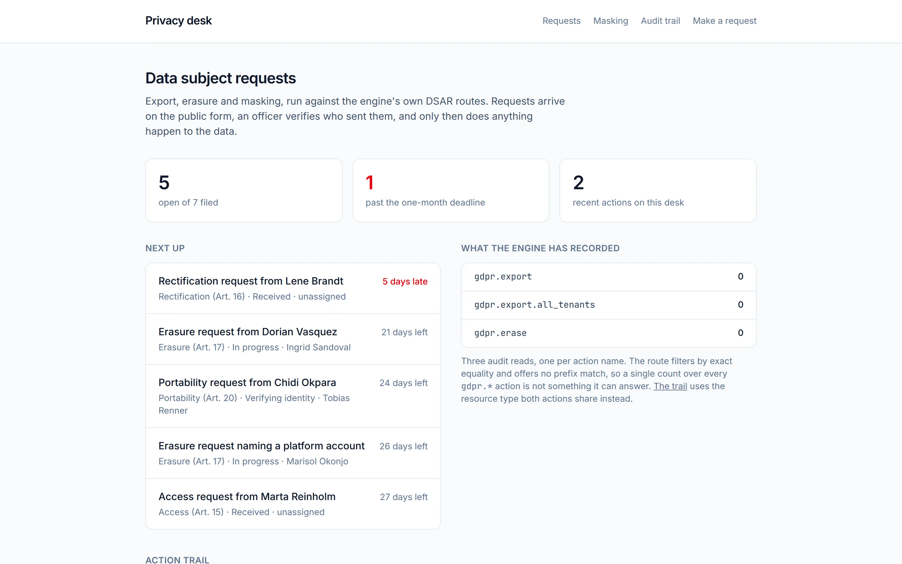</a> <b><a href="../apps/privacy-compliance/">privacy-compliance</a></b>, 7 pages Data-subject export and erasure, masking rules, an audit trail.</td>
  </tr>
  <tr>
    <td width="50%" valign="top"><a href="../apps/realtime-feed/#preview">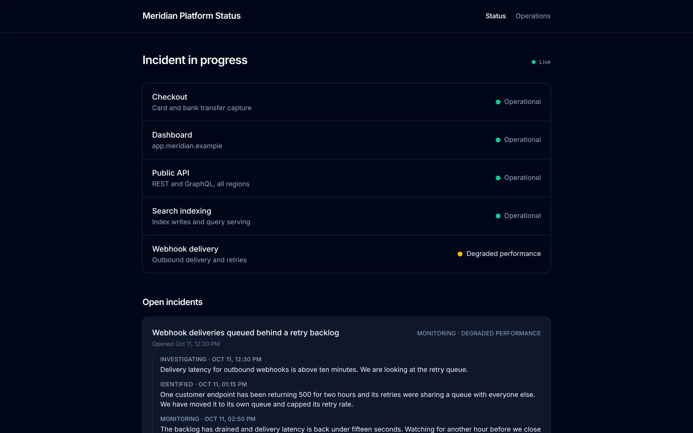</a> <b><a href="../apps/realtime-feed/">realtime-feed</a></b>, 2 pages A live status board pushed over the events stream, with no credential in the browser.</td>
    <td width="50%" valign="top"><a href="../apps/saas-multitenant/#preview">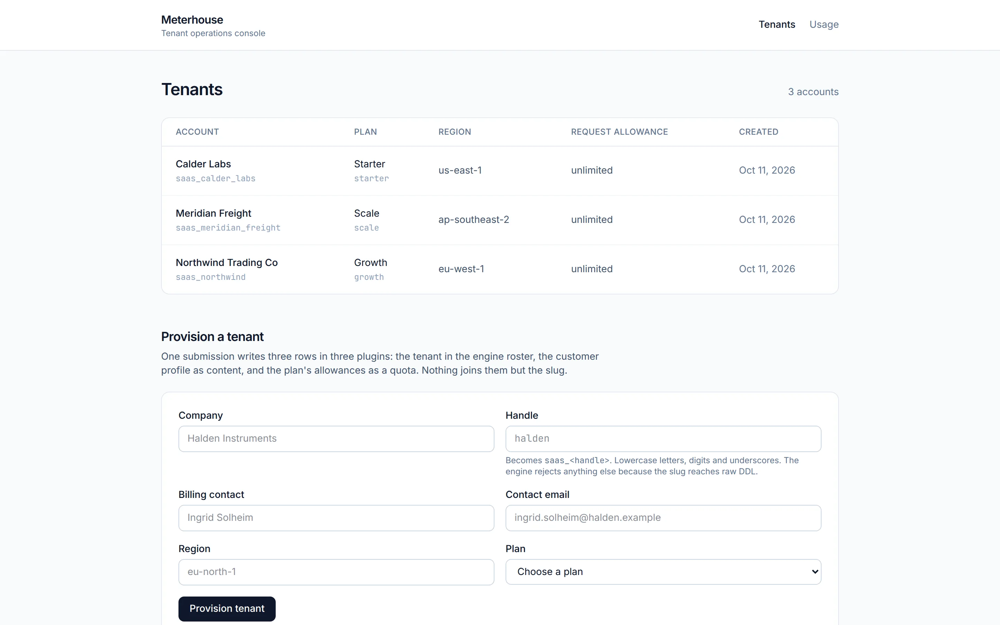</a> <b><a href="../apps/saas-multitenant/">saas-multitenant</a></b>, 3 pages Tenant provisioning, scoped API keys, usage metering.</td>
  </tr>
  <tr>
    <td width="50%" valign="top"><a href="../apps/search-console/#preview">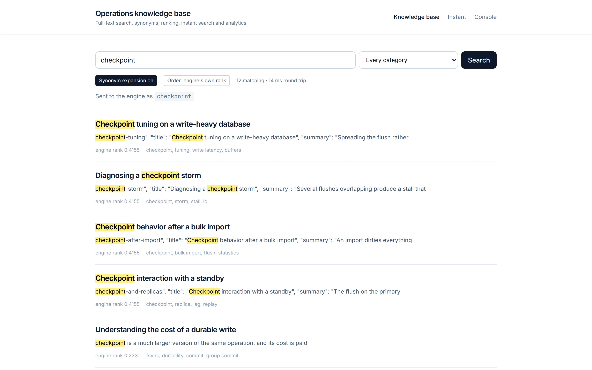</a> <b><a href="../apps/search-console/">search-console</a></b>, 4 pages The rest of the search plugin: synonyms, ranking, instant search, reindexing and caller-reported analytics.</td>
    <td width="50%" valign="top"><a href="../apps/subscription-gating/#preview">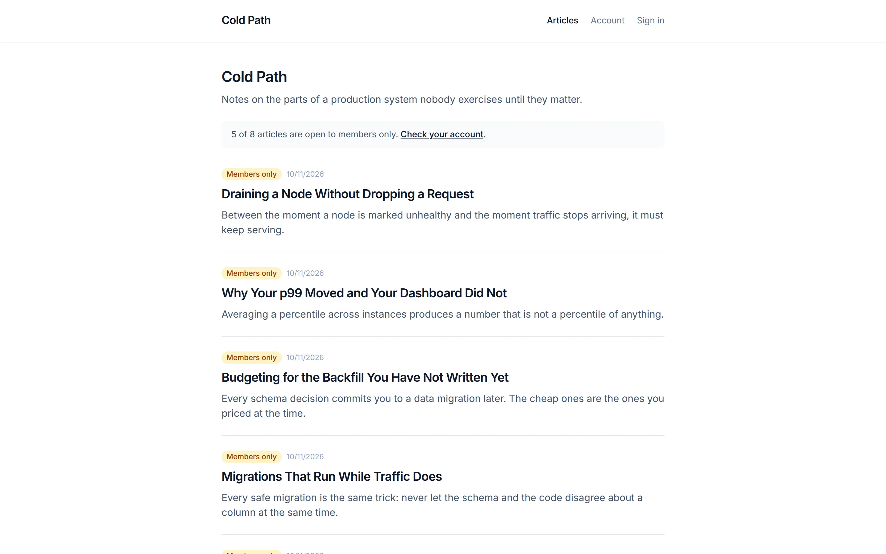</a> <b><a href="../apps/subscription-gating/">subscription-gating</a></b>, 2 pages Gating content on entitlements and receiving provider webhooks.</td>
  </tr>
  <tr>
    <td width="50%" valign="top"><a href="../apps/webhook-integrations/#preview">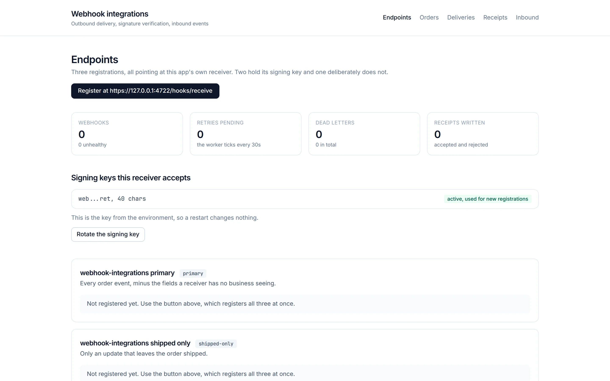</a> <b><a href="../apps/webhook-integrations/">webhook-integrations</a></b>, 5 pages Deliveries out with the signature verified, and signed requests in.</td>
  </tr>
</table>

[headless-node](../apps/headless-node/) has no pages to show: it runs in a terminal.
